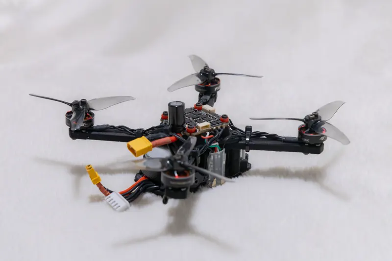

# lawlerlogan.github.io

Personal portfolio. Plain HTML, CSS and a little JavaScript, served by GitHub Pages. No build step.

```
index.html               home page (hero, about, projects, experience, skills, contact)
projects/<name>/         one page per project
assets/css/site.css      all styles
assets/js/site.js        smooth linked scrolling between projects and skills
assets/fonts/            STIX Two Text + Martian Mono (self-hosted, latin subset)
assets/js/dots.js        dot sculptures that read as a shape from one angle (jet, @, quadcopter, ...)
assets/js/cursor.js      light grey dot cluster that follows the mouse
source-images/<project>/  full-size originals (not published)
```

## Adding photos

1. Save the original in `source-images/<project>/` with a descriptive name (e.g. `uav-photo.jpg`). That folder is not published.
2. Export a compressed WebP copy into `assets/img/` (about 800 and 1600 px wide for page images, 800×600 for home covers).
3. Reference it with width/height set to the real pixel size to avoid layout shift:

```html

```

## Preview locally

```
python -m http.server 4000
```
